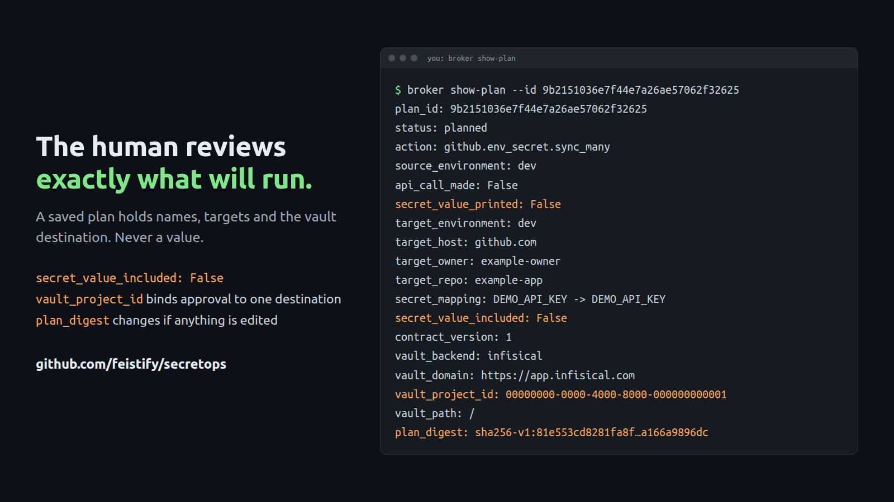

# Demo: enter once, sync through an approved plan

Do the [vault-only first check](INSTALL.md#first-check-vault-only) first. The demo uses `dev` as both the Infisical and the GitHub environment; you can use your own names instead, as long as the policy allows them (default: `dev` and `staging`, exact spelling; see [environment names](PREPARE.md#environment-names)).

After completing [installation and authentication](INSTALL.md), use a test Infisical project and a test GitHub repository with a `dev` environment. The commands below are for the installed local broker. Enter a made-up, single-line value for this demo; never give it to the agent. Run commands one at a time and stop on any failure; exit 3 means the agent must ask the human to resolve an unknown write outcome before continuing.

**Human, in your own terminal:**

```sh
secretops add DEMO_API_KEY --env dev
# Your sudo password may be asked first, then the hidden value and Save? [y/N]
# Saved and verified.
```

**Agent:** create two metadata-only recipes in a temporary directory; no secretops checkout is needed. Set `owner` and `repo` below to the test repository's owner and name before running the block. Keep this agent shell open for the remaining commands:

```sh
demo_dir=$(mktemp -d)
owner=example-owner repo=example-repo
cat > "$demo_dir/demo-sync.yaml" <<YAML
action: github.env_secret.sync_many
env: dev
github_owner: $owner
github_repo: $repo
github_environment: dev
secrets:
  - source: DEMO_API_KEY
    target: DEMO_API_KEY
YAML
cat > "$demo_dir/demo-verify.yaml" <<YAML
action: github.env_secret.verify_many
github_owner: $owner
github_repo: $repo
github_environment: dev
secrets:
  - name: DEMO_API_KEY
YAML
```

Upload the sync recipe and prepare its plan:

```sh
secretops-local write-recipe demo-sync.yaml < "$demo_dir/demo-sync.yaml"
secretops-local plan --file demo-sync.yaml --save
secretops-local show-plan --id SYNC_PLAN_ID
secretops-local preflight-plan --id SYNC_PLAN_ID
```

Replace `SYNC_PLAN_ID` with the ID returned by `plan`. If preflight fails, stop and tell the human. The agent cannot approve its own plan.

**Human:** review the source, destination, GitHub repository and environment, then approve through your own broker access:

```sh
sudo -u secretops-broker /usr/local/bin/secretops-broker show-plan --id SYNC_PLAN_ID
sudo -u secretops-broker /usr/local/bin/secretops-broker approve-plan --id SYNC_PLAN_ID
```



**Agent:** after approval, execute the sync and prepare a separate metadata-only verification plan:

```sh
secretops-local execute-plan --id SYNC_PLAN_ID
# OK GitHub writes acknowledged: 1
secretops-local write-recipe demo-verify.yaml < "$demo_dir/demo-verify.yaml"
secretops-local plan --file demo-verify.yaml --save
secretops-local preflight-plan --id VERIFY_PLAN_ID
secretops-local execute-plan --id VERIFY_PLAN_ID
# present names: DEMO_API_KEY
```

Replace `VERIFY_PLAN_ID` with the second plan's ID. Verification needs no approval under the default policy and confirms only that the name exists, not value equality. The human deletes the demo secrets from Infisical and GitHub when finished, after the optional section below if you do it. See [OPERATIONS.md](OPERATIONS.md) for failure handling and daily use.

## Optional: use the secret in a workflow

The verification above shows that the name exists in GitHub. To see that a job really receives the value, add a workflow that only checks that the secret is not empty. It never prints the value, its length or a hash. For a clear result, add the workflow and run it once after `secretops add` and before the sync plan, then return to the sync.

**Agent** (with its own access to the test repository, never the broker's GitHub login): propose this file as `.github/workflows/secretops-smoke.yml`, show the change, and publish it only after the human agrees. Look at the repository's other workflows first: a push can start them, and `[skip ci]` in the commit message prevents that. Do not add shell tracing. The workflow must be on the default branch before it can be started.

```yaml
name: secretops smoke test

on:
  workflow_dispatch:

permissions: {}

jobs:
  check-secret:
    runs-on: ubuntu-latest
    timeout-minutes: 2
    environment: dev
    steps:
      - name: Check that the secret is available
        shell: bash
        env:
          SMOKE_VALUE: ${{ secrets.DEMO_API_KEY }}
        run: |
          if [[ -z "$SMOKE_VALUE" ]]; then
            printf '%s\n' '::error::DEMO_API_KEY is missing or empty.'
            exit 1
          fi
          printf '%s\n' 'OK DEMO_API_KEY is available.'
```

**Human:** run it from the Actions tab once it is on the default branch, or let the agent start it with its own repository access.

| When | Expected |
| --- | --- |
| Before the sync | The job fails with `DEMO_API_KEY is missing or empty.` If it passes, a secret of that name already exists (in the environment, the repository or the organization); stop and find out why |
| After the sync | `OK DEMO_API_KEY is available.` |

Only the failing run shows that the later success comes from the sync. Before the second run, check that the workflow file on the default branch is still the reviewed one. A passing job proves that a non-empty value reached the job, not that it equals the value in the vault. If the environment has protection rules, the job waits for the required approval; that is not a missing secret. GitHub documents environment secrets for public repositories on every plan and for private repositories on paid plans; check yours ([managing environments](https://docs.github.com/en/actions/how-tos/deploy/configure-and-manage-deployments/manage-environments)).

One run of this, in a private repository where it worked on the Free plan for a reason not known, is recorded in [validation/github-actions-consumer.md](validation/github-actions-consumer.md).
