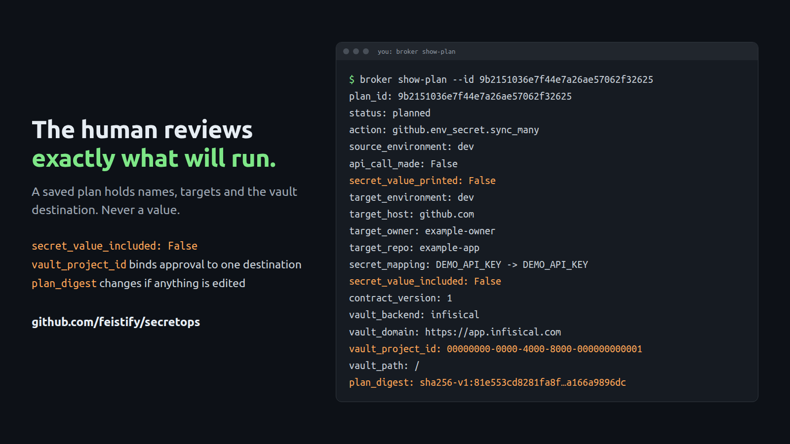

# Demo: enter once, sync through an approved plan

After completing [installation and authentication](INSTALL.md), use a test Infisical project and a test GitHub repository with a `dev` environment. The commands below are for the installed local broker. Enter a made-up, single-line value for this demo; never give it to the agent. Run commands one at a time and stop on any failure; exit 3 means the agent must ask the human to resolve an unknown write outcome before continuing.

**Human, in your own terminal:**

```sh
secretops add DEMO_API_KEY --env dev
# Your sudo password may be asked first, then the hidden value and Save? [y/N]
# Saved and verified.
```

**Agent:** create two metadata-only recipes in a temporary directory; no secretops checkout is needed. Set `owner` and `repo` below to the test repository's owner and name before running the block. Keep this agent shell open for the remaining commands:

```sh
demo_dir=$(mktemp -d)
owner=example-owner repo=example-repo
cat > "$demo_dir/demo-sync.yaml" <<YAML
action: github.env_secret.sync_many
env: dev
github_owner: $owner
github_repo: $repo
github_environment: dev
secrets:
  - source: DEMO_API_KEY
    target: DEMO_API_KEY
YAML
cat > "$demo_dir/demo-verify.yaml" <<YAML
action: github.env_secret.verify_many
github_owner: $owner
github_repo: $repo
github_environment: dev
secrets:
  - name: DEMO_API_KEY
YAML
```

Upload the sync recipe and prepare its plan:

```sh
secretops-local write-recipe demo-sync.yaml < "$demo_dir/demo-sync.yaml"
secretops-local plan --file demo-sync.yaml --save
secretops-local show-plan --id SYNC_PLAN_ID
secretops-local preflight-plan --id SYNC_PLAN_ID
```

Replace `SYNC_PLAN_ID` with the ID returned by `plan`. If preflight fails, stop and tell the human. The agent cannot approve its own plan.

**Human:** review the source, destination, GitHub repository and environment, then approve through your own broker access:

```sh
sudo -u secretops-broker /usr/local/bin/secretops-broker show-plan --id SYNC_PLAN_ID
sudo -u secretops-broker /usr/local/bin/secretops-broker approve-plan --id SYNC_PLAN_ID
```



**Agent:** after approval, execute the sync and prepare a separate metadata-only verification plan:

```sh
secretops-local execute-plan --id SYNC_PLAN_ID
# OK GitHub writes acknowledged: 1
secretops-local write-recipe demo-verify.yaml < "$demo_dir/demo-verify.yaml"
secretops-local plan --file demo-verify.yaml --save
secretops-local preflight-plan --id VERIFY_PLAN_ID
secretops-local execute-plan --id VERIFY_PLAN_ID
# present names: DEMO_API_KEY
```

Replace `VERIFY_PLAN_ID` with the second plan's ID. Verification needs no approval under the default policy and confirms only that the name exists, not value equality. The human deletes the demo secrets from Infisical and GitHub when finished. See [OPERATIONS.md](OPERATIONS.md) for failure handling and daily use.
